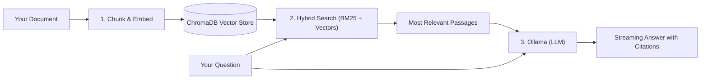

# My Private AI

> **Your private documents, your hardware.**  
> A 100% private, local Retrieval-Augmented Generation (RAG) assistant. Chat with your PDFs, Word docs, spreadsheets, code, and images entirely on your machine using **Ollama**, **ChromaDB**, and **FastAPI**. Zero data leaves your computer.  
> 
> 📖 **Visual Walkthrough:** See the 3-page printable [Beginner's Guide (PDF)](docs/beginners_guide.pdf) for an introduction to the concepts and architecture.

---

## What is RAG? (Explained in 60 Seconds)

If you ask an AI model like Llama 3 a question about your private company report or personal notes, it won't know the answer because it was never trained on your files.

**Retrieval-Augmented Generation (RAG)** solves this by turning AI into an **open-book exam**:



1. **Ingest & Chunk**: You upload a document (PDF, Excel, Docx, etc.). The app extracts the text, splits it into paragraph-sized chunks, and converts each chunk into an **embedding** (a list of numbers representing its meaning). These vectors are saved in **ChromaDB**.
2. **Retrieve**: When you ask a question, the app searches ChromaDB for semantically similar paragraphs and runs a **BM25 keyword search** for exact terms, combining both results using **Reciprocal Rank Fusion (RRF)**.
3. **Augment & Generate**: The app pastes the best passages and your conversation history into a prompt and hands it to **Ollama**, which streams the answer back to your screen in real time with source citations!

---

## Features

- **Real-Time Token Streaming**: Watch answers generate word-by-word with Server-Sent Events (SSE) and an animated glowing pulse cursor.
- **100% Offline Markdown & Code Highlighting**: Rich formatted responses with syntax-highlighted code blocks, tables, and one-click copy buttons without external CDNs.
- **Persistent Conversation Threads & New Chat**: Browse your past conversation threads in the sidebar, switch between them with one click, start fresh sessions via "+ New Chat", or delete old threads. All history is persisted in SQLite (`chroma_db/chat_history.db`).
- **Hybrid Search (BM25 + Dense Vectors)**: Combines semantic vector similarity with pure-Python BM25 keyword matching to accurately retrieve both conceptual ideas and exact product codes/names.
- **OCR Fallback for Scanned PDFs & Images**: Built-in Tesseract OCR automatically extracts text from scanned image-only PDFs and standalone screenshots (`.png`, `.jpg`, `.webp`).
- **Interactive Workspace Manager**: Easily switch between isolated project spaces (e.g. `finance`, `legal`, `engineering`) via a dropdown switcher showing live file and conversation counts. Includes a "+ Create Workspace" modal dialog and workspace deletion capability with full database and vector cleanup.

---

## Project Directory Structure

```text
my-private-ai/
│
├── app.py                   # FastAPI server entry point and static asset mount
├── compose.yaml             # Docker Compose stack (Ollama + Web App)
├── Dockerfile               # Container build instructions with Tesseract OCR
├── requirements.txt         # Python dependencies
│
├── docs/                    # Project documentation and guides
│   └── beginners_guide.pdf  # Printable 3-page visual beginner's guide & architecture
│
├── core/                    # Core configuration and database layer
│   ├── config.py            # Environment variables, file limits, supported formats
│   └── db.py                # ChromaDB vector store + SQLite chat persistence
│
├── services/                # Business logic & AI algorithms
│   ├── chunker.py           # Boundary-aware text splitter (paragraphs & sentences)
│   ├── extractors.py        # Text & OCR extraction (PDF, DOCX, XLSX, PPTX, Images)
│   ├── ollama.py            # Async client for Ollama embeddings and streaming
│   └── rag.py               # BM25 sparse search engine & Reciprocal Rank Fusion
│
├── routers/                 # REST API endpoints
│   ├── health.py            # GET /api/health (Ollama status & chunk counter)
│   ├── files.py             # Workspaces CRUD & File uploads/deletions
│   └── chat.py              # POST /api/chat (SSE streaming) & GET /api/chat/history
│
├── static/                  # Frontend single-page application (Clean & Modular)
│   ├── index.html           # Semantic HTML structure (< 280 lines)
│   ├── style.css            # Responsive layout, themes, loader, and cursor animations
│   ├── app.js               # Event handling, SSE streaming reader, upload logic
│   ├── marked.min.js        # Offline GitHub Flavored Markdown parser
│   ├── highlight.min.js     # Offline code syntax highlighter
│   └── highlight.min.css    # Dark code theme
│
├── sample_files/            # Sample documents for testing and onboarding
│   ├── sample_project_report.pdf         # PDF report with tasks, deadlines, budget, and table
│   ├── sample_service_agreement.docx     # Word doc with contract milestones, SLAs, and pricing
│   ├── sample_quarterly_financials.csv   # Spreadsheet with regional revenue, units, and profits
│   ├── sample_policy_faq.html            # HTML corporate policy & IT security FAQ guide
│   └── test.txt                          # Minimal plain text document
│
└── tests/                   # Automated unit tests (18 passing tests)
    ├── test_bm25.py         # BM25 ranking and scoring tests
    ├── test_chunker.py      # Boundary-aware text chunking tests
    ├── test_db.py           # SQLite message history & workspace isolation tests
    ├── test_extractors.py   # Multi-format decoding and extraction tests
    └── test_workspaces.py   # Workspace CRUD lifecycle and validation tests
```

---

## Quickstart Guide

### Option 1: Run with Docker Compose (Recommended)

Everything runs inside preconfigured containers with all OCR and Python libraries installed.

1. **Start the stack**:
   ```bash
   docker compose up -d
   ```

2. **Pull the required models** (only needed once):
   ```bash
   # Pull the chat model (approx 2.0 GB)
   docker exec -it ollama ollama pull llama3.2

   # Pull the embedding model (approx 274 MB)
   docker exec -it ollama ollama pull nomic-embed-text
   ```

3. **Open your browser**:
   Navigate to [http://localhost:8000](http://localhost:8000).

---

### Option 2: Run Locally on Host (Python 3.10+)

1. **Install and start Ollama**:
   Download Ollama from [ollama.com](https://ollama.com) and pull models:
   ```bash
   ollama pull llama3.2
   ollama pull nomic-embed-text
   ```

2. **Set up a Python virtual environment**:
   ```powershell
   python -m venv .venv
   .venv\Scripts\Activate.ps1   # On Windows
   # source .venv/bin/activate  # On macOS/Linux
   ```

3. **Install dependencies**:
   ```bash
   pip install -r requirements.txt
   ```

4. **Start the server**:
   ```bash
   uvicorn app:app --reload --port 8000
   ```
   Open [http://localhost:8000](http://localhost:8000).

---

## Sample Files for Testing & Verification

The repository provides ready-to-use sample documents in [`sample_files/`](sample_files/) to test ingestion, chunking, OCR, and hybrid RAG retrieval right after installation:

| File | Format | Description | Suggested Test Query |
|---|---|---|---|
| `sample_project_report.pdf` | PDF | "Smart Office Upgrade" report containing project manager (Priya Sharma), timeline, budget (INR 150,000), and a tabular task breakdown. | *"Who is the project manager and what is the total budget?"* |
| `sample_service_agreement.docx` | Word (`.docx`) | Master Services Agreement containing contract milestones ($280,000 total value), SLAs (99.95% uptime), and payment schedules. | *"What is the total contract value and what are the SLA response times for Severity 1?"* |
| `sample_quarterly_financials.csv` | Spreadsheet (`.csv`) | 2026 Quarterly performance across 4 regions with units sold, revenue, marketing spend, and lead executives. | *"Which region had the highest revenue for Enterprise Cloud AI in Q3 2026?"* |
| `sample_policy_faq.html` | HTML | "Employee Handbook & IT Security Guide" containing PTO rules, remote work stipends ($750), password policies, and security contacts. | *"What is the remote work stipend and how many PTO days are allowed?"* |
| `test.txt` | Text | Simple single-sentence plain text document for quick boundary checks. | *"What is the budget mentioned in test.txt?"* |

### Quick Verification Walkthrough:
1. Open the web interface at [http://localhost:8000](http://localhost:8000).
2. Click the **Documents** tab in the sidebar.
3. Drag and drop `sample_files/sample_project_report.pdf` into the upload dropzone and click **Upload and Index**.
4. Once indexed, click **New Conversation** (or use the starter chips).
5. Ask: *"What are the project tasks and who owns each task?"*
6. Observe real-time streaming tokens and verify the source citation pill referencing `sample_project_report.pdf`.

---

## Running the Automated Tests

The project includes unit tests covering the BM25 search engine, chunking boundaries, SQLite persistence, and text extraction:

```bash
# Inside Docker:
docker exec my-private-ai pytest -v

# Or locally:
pytest -v
```

Expected output:
```text
tests/test_bm25.py::test_bm25_empty PASSED
tests/test_bm25.py::test_bm25_keyword_ranking PASSED
tests/test_bm25.py::test_bm25_non_matching_query PASSED
tests/test_chunker.py::test_split_text_empty PASSED
tests/test_chunker.py::test_split_text_short PASSED
tests/test_chunker.py::test_split_text_paragraph_break PASSED
tests/test_chunker.py::test_split_text_respects_sentence_boundary PASSED
tests/test_db.py::test_sqlite_chat_persistence PASSED
tests/test_db.py::test_list_conversations PASSED
tests/test_db.py::test_workspace_isolation_and_deletion PASSED
tests/test_extractors.py::test_decode_text_utf8 PASSED
tests/test_extractors.py::test_decode_text_cp1252 PASSED
tests/test_extractors.py::test_extract_text_json PASSED
tests/test_extractors.py::test_extract_text_html PASSED
tests/test_workspaces.py::test_get_workspaces PASSED
tests/test_workspaces.py::test_create_and_delete_workspace PASSED
tests/test_workspaces.py::test_cannot_delete_default_workspace PASSED
tests/test_workspaces.py::test_create_workspace_invalid_name PASSED
============================== 18 passed in 2.34s ==============================
```

---

## Configuration Settings

Customize behavior via environment variables in `compose.yaml` or a `.env` file:

| Variable | Default | What it Does |
|---|---|---|
| `OLLAMA_BASE_URL` | `http://localhost:11434` | Address of your local Ollama instance |
| `OLLAMA_MODEL` | `llama3.2` | Model used for conversation and reasoning |
| `OLLAMA_EMBED_MODEL` | `nomic-embed-text` | Model used for document and query vector embeddings |
| `CHROMA_DB_PATH` | `./chroma_db` | Folder where ChromaDB vector index is saved |
| `UPLOAD_DIR` | `./uploads` | Folder where uploaded original documents are kept |
| `MAX_FILE_MB` | `25` | Maximum upload size per file (in megabytes) |
| `RETRIEVAL_TOP_K` | `5` | Number of document chunks retrieved per user question |
| `MAX_HISTORY_MESSAGES`| `12` | Number of previous chat messages passed for context |

---

## Privacy & Security

- **100% Local**: No external telemetry, no remote API calls, no third-party trackers.
- **Offline Capable**: All fonts, CSS styles, JavaScript libraries, and models run locally from disk.
- **Safe Sandboxing**: Document text is isolated and cited with filenames; prompt injection defenses distinguish source text from system instructions.
