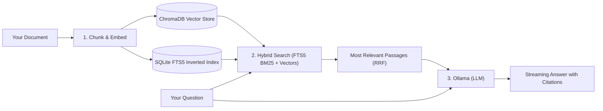

# My Private AI

> **Your private documents, your hardware.**  
> A 100% private, local Retrieval-Augmented Generation (RAG) assistant. Chat with your PDFs, Word docs, spreadsheets, code, and images entirely on your machine using **Ollama**, **ChromaDB**, and **FastAPI**. Zero data leaves your computer.  
> 
> **Visual Walkthrough:** See the 3-page printable [Beginner's Guide (PDF)](docs/beginners_guide.pdf) for an introduction to the concepts and architecture.  
> **Architecture Blueprint:** See the comprehensive [Architecture & Audit Report](docs/architecture_analysis.md) for production re-architecture and enterprise benchmarks.

---

## What is RAG? (Explained in 60 Seconds)

If you ask an AI model like Llama 3 a question about your private company report or personal notes, it won't know the answer because it was never trained on your files.

**Retrieval-Augmented Generation (RAG)** solves this by turning AI into an **open-book exam**:



1. **Ingest & Chunk**: You upload a document (PDF, Excel, Docx, etc.). The app extracts the text, splits it into paragraph-sized chunks, and converts each chunk into an **embedding** (a list of numbers representing its meaning). Vectors are saved in **ChromaDB**, and exact text is indexed in **SQLite FTS5**.
2. **Retrieve**: When you ask a question, the app searches ChromaDB for semantically similar paragraphs and runs a **BM25 keyword search** via SQLite FTS5 for exact terms, combining both results using **Reciprocal Rank Fusion (RRF)**.
3. **Augment & Generate**: The app pastes the best passages and your conversation history into a prompt and hands it to **Ollama**, which streams the answer back to your screen in real time with source citations!

---

## Features

- **Role-Based Access Control (RBAC) & Centralized ACL**: Production-ready enterprise governance with 5 default roles (`Super Admin`, `Admin`, `Manager`, `User`, `Viewer`), custom roles support, module-grouped permissions, and granular user-level permission overrides (Allow / Deny ACLs).
- **Dedicated Admin Dashboard UI**: Professional, modern administration interface with responsive collapsible sidebar, KPI metrics cards, real-time activity stream, and authentication audit timeline.
- **Dynamic User Management**: Complete CRUD operations, user directory search/filter/sort/pagination, activation & deactivation, password reset, multi-role assignment, and self-protection guardrails.
- **Dynamic Role Management**: Create custom roles, configure granular permissions with module-level batch selection, assign users, and protect system roles against deletion.
- **Tamper-Proof Read-Only Audit Logging**: Append-only security audit trail tracking user administration, role/permission updates, login/logout events, and failed attempts, with one-click CSV and JSON export.
- **User Authentication & Multi-User Isolation**: Secure local user registration and login with bcrypt password hashing and session tokens. All workspaces, uploaded documents, vector chunks, and conversation histories are strictly isolated per user.
- **Dynamic Model Switcher & Download Manager**: Switch conversational Ollama models on the fly directly in the chat bar (e.g., Llama 3.2, Qwen 2.5, DeepSeek-R1, Mistral, Phi-3). Download new models from Ollama with real-time Server-Sent Events (SSE) download progress and manage installed models inside the UI.
- **Real-Time Token Streaming**: Watch answers generate word-by-word with Server-Sent Events (SSE), glowing pulse cursor animations, and real-time generation speed metrics.
- **Hybrid Search (SQLite FTS5 BM25 + ChromaDB Vectors + RRF)**: Combines semantic vector similarity with native SQLite FTS5 BM25 keyword matching using Reciprocal Rank Fusion to accurately retrieve both conceptual ideas and exact product codes or names.
- **Dynamic Context-Aware Starter Chips**: Welcome screen automatically analyzes indexed document titles and content to suggest tailored starter prompts, falling back to versatile general prompts when no documents are attached.
- **Document Text & Chunk Preview Modal**: Inspect extracted text, character counts, and sample vector chunk snippets with metadata directly from the document manager before or after querying.
- **100% Offline Markdown & Code Highlighting**: Rich formatted responses with syntax-highlighted code blocks, tables, and one-click copy buttons without external CDNs.
- **Conversation Threads & Export**: Browse past conversation threads in the sidebar, switch between them with one click, start fresh sessions via "+ New Chat", or export any thread to formatted GitHub Flavored Markdown or structured JSON.
- **Interactive Workspace Manager**: Easily switch between isolated project spaces (e.g. `finance`, `legal`, `engineering`) via a dropdown switcher showing live file and conversation counts. Includes a "+ Create Workspace" modal dialog and workspace deletion capability with full database and vector cleanup.
- **Collapsible Navigation & Workspace Cards**: Compact collapsible navigation sidebar (`Ctrl+B`), quick document attachment button right beside the chat input, and collapsible workspace cards for maximum screen real estate.
- **In-Browser Voice Dictation**: Hands-free speech-to-text input powered by the Web Speech API with an interactive audio waveform HUD.
- **Dark & Light Mode Themes**: Full theme switcher with system preference auto-detection, persistent local preference, and `Ctrl+Shift+D` keyboard shortcut.
- **OCR Fallback for Scanned PDFs & Images**: Built-in Tesseract OCR automatically extracts text from scanned image-only PDFs and standalone screenshots (`.png`, `.jpg`, `.webp`).

---

## Project Directory Structure

```text
my-private-ai/
│
├── app.py                       # FastAPI server entry point and static asset mount
├── compose.yaml                 # Docker Compose stack (Ollama + Web App)
├── Dockerfile                   # Container build instructions with Tesseract OCR
├── requirements.txt             # Python dependencies
├── .env.example                 # Environment configuration template
│
├── docs/                        # Project documentation and architectural guides
│   ├── beginners_guide.pdf      # Printable 3-page visual beginner's guide & architecture
│   └── architecture_analysis.md # Enterprise architecture analysis & technical audit report
│
├── core/                        # Core configuration, authentication, RBAC & database layer
│   ├── audit.py                 # Immutable audit logging engine (CSV/JSON export, IP capture)
│   ├── auth.py                  # User registration, bcrypt hashing, session tokens & dependencies
│   ├── config.py                # Environment variables, file limits, supported formats
│   ├── db.py                    # ChromaDB vector store + SQLite FTS5, RBAC migrations & persistence
│   └── rbac.py                  # Centralized RBAC/ACL authorization, effective permissions & roles
│
├── services/                    # Business logic & AI algorithms
│   ├── chunker.py               # Boundary-aware text splitter (paragraphs & sentences)
│   ├── extractors.py            # Text & OCR extraction (PDF, DOCX, XLSX, PPTX, Images)
│   ├── ollama.py                # Async client for Ollama embeddings and streaming
│   ├── rag.py                   # BM25 sparse search engine & Reciprocal Rank Fusion
│   └── starter_prompts.py       # Document-aware dynamic starter prompt generator
│
├── routers/                     # REST API endpoints
│   ├── admin.py                 # Admin dashboard endpoints (Users, Roles, Permissions, Logs, Settings)
│   ├── auth.py                  # User authentication (register, login, logout, me with roles/perms)
│   ├── chat.py                  # POST /api/chat (SSE streaming), history, export & starter prompts
│   ├── files.py                 # Workspaces CRUD, file uploads/deletions & chunk preview
│   ├── health.py                # GET /api/health (Ollama status & chunk counter)
│   └── models.py                # Local Ollama model catalog, model pull SSE & deletion
│
├── static/                      # Frontend single-page application (Clean & Modular)
│   ├── index.html               # Semantic HTML structure & modal dialogs
│   ├── style.css                # Responsive layout, dark/light themes, waveform HUD & animations
│   ├── app.js                   # Event handling, SSE streaming reader, upload & auth logic
│   ├── marked.min.js            # Offline GitHub Flavored Markdown parser
│   ├── highlight.min.js         # Offline code syntax highlighter
│   └── highlight.min.css        # Dark code theme
│
├── sample_files/                # Sample documents for testing and onboarding
│   ├── sample_project_report.pdf         # PDF report with tasks, deadlines, budget, and table
│   ├── sample_service_agreement.docx     # Word doc with contract milestones, SLAs, and pricing
│   ├── sample_quarterly_financials.csv   # Spreadsheet with regional revenue, units, and profits
│   ├── sample_policy_faq.html            # HTML corporate policy & IT security FAQ guide
│   └── test.txt                          # Minimal plain text document
│
└── tests/                       # Automated unit & integration tests (45 passing tests)
    ├── test_auth.py             # User registration, login, and session lifecycle tests
    ├── test_auth_api.py         # Authentication API endpoint flow tests
    ├── test_bm25.py             # BM25 ranking and scoring tests
    ├── test_chunker.py          # Boundary-aware text chunking tests
    ├── test_db.py               # SQLite message history & workspace isolation tests
    ├── test_extractors.py       # Multi-format decoding and extraction tests
    ├── test_files_auth.py       # Document upload auth & user isolation tests
    ├── test_fts5_and_documents.py # SQLite FTS5 search, metadata chunking & export tests
    ├── test_models_api.py       # Model catalog, sizing, and pull validation tests
    ├── test_starter_prompts.py  # Generic and dynamic document-aware starter prompt tests
    └── test_workspaces.py       # Workspace CRUD lifecycle, validation & isolation tests
```

---

## Quickstart Guide

### Option 1: Run with Docker Compose (Recommended)

Everything runs inside preconfigured containers with all OCR and Python libraries installed.

1. **Start the stack**:
   ```bash
   docker compose up -d
   ```

2. **Pull the required models** (only needed once):
   ```bash
   # Pull the chat model (approx 2.0 GB)
   docker exec -it ollama ollama pull llama3.2

   # Pull the embedding model (approx 274 MB)
   docker exec -it ollama ollama pull nomic-embed-text
   ```

3. **Open your browser**:
   Navigate to [http://localhost:8000](http://localhost:8000).

---

### Option 2: Run Locally on Host (Python 3.10+)

1. **Install and start Ollama**:
   Download Ollama from [ollama.com](https://ollama.com) and pull models:
   ```bash
   ollama pull llama3.2
   ollama pull nomic-embed-text
   ```

2. **Set up a Python virtual environment**:
   ```powershell
   python -m venv .venv
   .venv\Scripts\Activate.ps1   # On Windows
   # source .venv/bin/activate  # On macOS/Linux
   ```

3. **Install dependencies**:
   ```bash
   pip install -r requirements.txt
   ```

4. **Start the server**:
   ```bash
   uvicorn app:app --reload --port 8000
   ```
   Open [http://localhost:8000](http://localhost:8000).

---

## REST API Reference

The application provides a modular REST API structured across focused routers:

| Area | Method | Endpoint | Description |
|---|---|---|---|
| **Auth** | `POST` | `/api/auth/register` | Register new user account with bcrypt password hashing |
| | `POST` | `/api/auth/login` | Sign in user and issue HTTP-only session cookie / token |
| | `POST` | `/api/auth/logout` | Revoke active user session |
| | `GET` | `/api/auth/me` | Fetch active authenticated user profile |
| | `POST` | `/api/auth/avatar` | Upload and optimize user profile picture (PNG, JPG, WebP) |
| | `DELETE` | `/api/auth/avatar` | Remove user profile picture and revert to default avatar |
| **Models** | `GET` | `/api/models` | List installed Ollama models and curated catalog |
| | `POST` | `/api/models/pull` | Download new Ollama model with real-time SSE progress |
| | `DELETE` | `/api/models/{model_name}` | Delete local model from Ollama storage |
| **Workspaces**| `GET` | `/api/workspaces` | List user workspaces with document, conversation & chunk counts |
| | `POST` | `/api/workspaces` | Create a new isolated workspace |
| | `DELETE` | `/api/workspaces` | Delete workspace and all associated documents & vectors |
| **Documents** | `GET` | `/api/files` | List uploaded documents in active workspace |
| | `POST` | `/api/upload` | Upload and index documents with OCR fallback |
| | `DELETE` | `/api/files` | Delete document from disk, SQLite, and ChromaDB vectors |
| | `GET` | `/api/files/preview` | Preview extracted text and sample vector chunks |
| **Chat** | `POST` | `/api/chat` | SSE streaming or standard chat response with source citations |
| | `GET` | `/api/chat/history` | Retrieve conversation turn history from SQLite |
| | `GET` | `/api/chat/conversations` | List conversation threads in active workspace |
| | `DELETE` | `/api/chat/conversations` | Delete specific conversation thread |
| | `POST` | `/api/chat/reset` | Clear messages in a conversation thread |
| | `GET` | `/api/chat/export` | Export conversation as Markdown or JSON |
| | `GET` | `/api/chat/starter-prompts`| Get dynamic document-specific or generic starter prompt chips |
| **Health** | `GET` | `/api/health` | Connectivity check for Ollama, active models, and chunk counts |

---

## Sample Files for Testing & Verification

The repository provides ready-to-use sample documents in [`sample_files/`](sample_files/) to test ingestion, chunking, OCR, and hybrid RAG retrieval right after installation:

| File | Format | Description | Suggested Test Query |
|---|---|---|---|
| `sample_project_report.pdf` | PDF | "Smart Office Upgrade" report containing project manager (Priya Sharma), timeline, budget (INR 150,000), and a tabular task breakdown. | *"Who is the project manager and what is the total budget?"* |
| `sample_service_agreement.docx` | Word (`.docx`) | Master Services Agreement containing contract milestones ($280,000 total value), SLAs (99.95% uptime), and payment schedules. | *"What is the total contract value and what are the SLA response times for Severity 1?"* |
| `sample_quarterly_financials.csv` | Spreadsheet (`.csv`) | 2026 Quarterly performance across 4 regions with units sold, revenue, marketing spend, and lead executives. | *"Which region had the highest revenue for Enterprise Cloud AI in Q3 2026?"* |
| `sample_policy_faq.html` | HTML | "Employee Handbook & IT Security Guide" containing PTO rules, remote work stipends ($750), password policies, and security contacts. | *"What is the remote work stipend and how many PTO days are allowed?"* |
| `test.txt` | Text | Simple single-sentence plain text document for quick boundary checks. | *"What is the budget mentioned in test.txt?"* |

### Quick Verification Walkthrough:
1. Open the web interface at [http://localhost:8000](http://localhost:8000).
2. Click **Sign In** in the top-right header and create a quick local account (e.g., `user` / `pass123`).
3. Click the **Documents** tab in the sidebar (or use the paperclip icon in the chat bar).
4. Drag and drop `sample_files/sample_project_report.pdf` into the upload dropzone and click **Upload and Index**.
5. Once indexed, notice the **dynamic starter prompt chips** generated automatically from the document.
6. Click one of the dynamic chips or ask: *"What are the project tasks and who owns each task?"*
7. Observe real-time streaming tokens and verify the source citation pill referencing `sample_project_report.pdf`.

---

## Running the Automated Tests

The project includes an automated test suite with **58 passing unit and integration tests across 14 test modules**, covering RBAC/ACL authorization, admin endpoints, immutable audit logging, authentication, multi-user isolation, BM25/FTS5 search, chunking boundaries, and text extraction:

```bash
# Inside Docker:
docker exec my-private-ai pytest -v

# Or locally:
pytest -v
```

Expected output:
```text
tests/test_admin_api.py::test_admin_api_authorization_gates PASSED
tests/test_admin_api.py::test_admin_user_crud_and_status PASSED
tests/test_admin_api.py::test_admin_roles_and_permissions PASSED
tests/test_admin_api.py::test_audit_logs_and_settings_api PASSED
tests/test_auth.py::test_user_registration_and_login PASSED
tests/test_auth.py::test_session_lifecycle PASSED
tests/test_auth.py::test_session_expiration PASSED
tests/test_auth.py::test_chat_history_user_isolation PASSED
tests/test_auth.py::test_first_user_adopts_legacy_messages PASSED
tests/test_auth_api.py::test_auth_api_flow PASSED
tests/test_avatar_api.py::test_upload_avatar_success PASSED
tests/test_avatar_api.py::test_upload_avatar_invalid_file_rejected PASSED
tests/test_bm25.py::test_is_greeting_or_smalltalk PASSED
tests/test_bm25.py::test_bm25_empty PASSED
tests/test_bm25.py::test_bm25_keyword_ranking PASSED
tests/test_bm25.py::test_bm25_non_matching_query PASSED
tests/test_chunker.py::test_split_text_empty PASSED
tests/test_chunker.py::test_split_text_short PASSED
tests/test_chunker.py::test_split_text_paragraph_break PASSED
tests/test_chunker.py::test_split_text_respects_sentence_boundary PASSED
tests/test_db.py::test_sqlite_chat_persistence PASSED
tests/test_db.py::test_list_conversations PASSED
tests/test_db.py::test_workspace_isolation_and_deletion PASSED
tests/test_extractors.py::test_decode_text_utf8 PASSED
tests/test_extractors.py::test_decode_text_cp1252 PASSED
tests/test_extractors.py::test_extract_text_json PASSED
tests/test_extractors.py::test_extract_text_html PASSED
tests/test_files_auth.py::test_unauthenticated_upload_rejected PASSED
tests/test_files_auth.py::test_user_document_isolation PASSED
tests/test_files_auth.py::test_rag_search_user_isolation[asyncio] PASSED
tests/test_fts5_and_documents.py::test_documents_crud PASSED
tests/test_fts5_and_documents.py::test_fts5_search_and_ranking PASSED
tests/test_fts5_and_documents.py::test_split_text_with_metadata PASSED
tests/test_fts5_and_documents.py::test_cleanup_expired_sessions PASSED
tests/test_fts5_and_documents.py::test_export_conversation_api PASSED
tests/test_models_api.py::test_format_size PASSED
tests/test_models_api.py::test_pull_model_request_validation PASSED
tests/test_models_api.py::test_list_models_api PASSED
tests/test_rbac.py::test_default_roles_and_permissions_seeded PASSED
tests/test_rbac.py::test_first_user_receives_super_admin PASSED
tests/test_rbac.py::test_granular_acl_permission_overrides PASSED
tests/test_rbac.py::test_user_activation_and_deactivation PASSED
tests/test_rbac.py::test_self_protection_rules PASSED
tests/test_rbac.py::test_custom_role_management PASSED
tests/test_rbac.py::test_audit_logging_and_export PASSED
tests/test_starter_prompts.py::test_generic_starter_chips_when_no_documents PASSED
tests/test_starter_prompts.py::test_title_extraction PASSED
tests/test_starter_prompts.py::test_single_document_dynamic_chips PASSED
tests/test_starter_prompts.py::test_multi_document_dynamic_chips PASSED
tests/test_starter_prompts.py::test_lifecycle_starter_prompts PASSED
tests/test_starter_prompts.py::test_api_starter_prompts_endpoint PASSED
tests/test_workspaces.py::test_unauthenticated_workspaces_blocked PASSED
tests/test_workspaces.py::test_get_workspaces PASSED
tests/test_workspaces.py::test_create_and_delete_workspace PASSED
tests/test_workspaces.py::test_cannot_delete_default_workspace PASSED
tests/test_workspaces.py::test_create_workspace_invalid_name PASSED
tests/test_workspaces.py::test_user_workspace_isolation PASSED
tests/test_workspaces.py::test_same_workspace_name_different_users PASSED
============================== 58 passed in 3.12s ==============================
```

---

## Configuration Settings

Customize behavior via environment variables in `compose.yaml` or a `.env` file:

| Variable | Default | What it Does |
|---|---|---|
| `OLLAMA_BASE_URL` | `http://localhost:11434` | Address of your local Ollama instance |
| `OLLAMA_MODEL` | `llama3.2` | Model used for conversation and reasoning |
| `OLLAMA_EMBED_MODEL` | `nomic-embed-text` | Model used for document and query vector embeddings |
| `OLLAMA_NUM_CTX` | `8192` | Maximum context window size passed to Ollama inference |
| `DEFAULT_TEMPERATURE` | `0.2` | Sampling temperature for model response generation |
| `CHROMA_DB_PATH` | `./chroma_db` | Folder where ChromaDB vector index is saved |
| `SQLITE_DB_PATH` | `./chroma_db/chat_history.db` | File path for SQLite database (users, sessions, documents, chat) |
| `UPLOAD_DIR` | `./uploads` | Folder where uploaded original documents are kept |
| `MAX_FILE_MB` | `25` | Maximum upload size per file (in megabytes) |
| `RETRIEVAL_TOP_K` | `5` | Number of document chunks retrieved per user question |
| `MAX_RETRIEVAL_DISTANCE`| `0.52` | Cosine distance relevance threshold for ChromaDB matches |
| `MAX_HISTORY_MESSAGES`| `12` | Number of previous chat messages passed for context |
| `ALLOWED_ORIGINS` | `http://localhost:8000,http://127.0.0.1:8000` | Allowed CORS origins for API requests |

---

## Privacy & Security

- **100% Local**: No external telemetry, no remote API calls, no third-party trackers.
- **Strict User Isolation**: Multi-user workspaces, documents, and conversations are cryptographically scoped and validated per authenticated session.
- **Bcrypt Credential Security**: Passwords hashed locally with salted bcrypt; sessions protected via HTTP-only tokens.
- **Offline Capable**: All fonts, CSS styles, JavaScript libraries, and AI models run locally from disk.
- **Safe Sandboxing**: Document text is isolated and cited with filenames; prompt injection defenses distinguish source text from system instructions.
