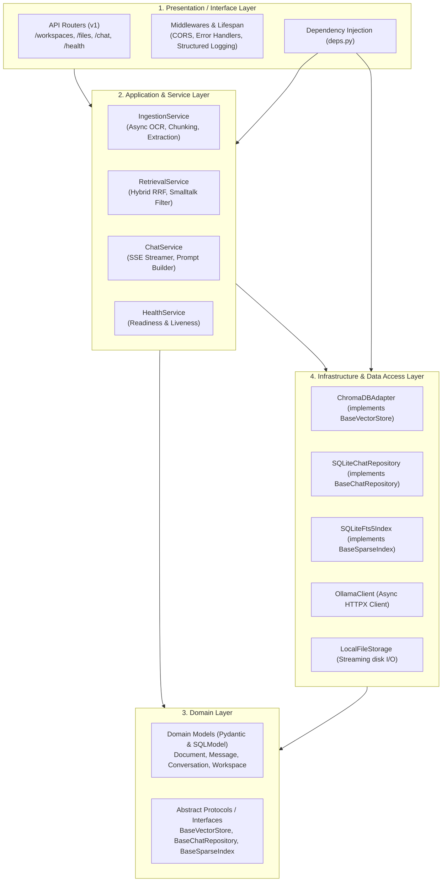

# Enterprise Architecture Analysis & Technical Audit Report
**Project Name:** My Private AI  
**Repository Path:** `c:\xampp\htdocs\my-private-ai`  
**Current Version:** 2.0.0  
**Audit Role:** Senior Software Architect, Technical Lead, and Code Quality Auditor  
**Audit Date:** November 4, 2026  
**Status:** Complete Audit & Production Re-Architecture Blueprint  

---

## Executive Summary

An architectural audit of the **My Private AI** codebase was conducted. The project is an offline, privacy-first Retrieval-Augmented Generation (RAG) system built with **FastAPI**, **Ollama**, **ChromaDB**, and **SQLite**, with a vanilla JavaScript Single-Page Application (SPA) frontend.

The system demonstrates functional core algorithms (boundary-aware chunking, multi-format text parsing, reciprocal rank fusion hybrid search, and Server-Sent Events token streaming). However, the application exhibits architectural smells, technical debt, and concurrency bottlenecks that impede enterprise reliability, security, maintainability, and horizontal scalability:

1. **Concurrency & Event Loop Starvation:** Heavy synchronous CPU-bound operations (Tesseract OCR, PyPDF parsing, Pandas Excel transformations) and synchronous disk I/O (SQLite queries) are invoked directly inside asynchronous FastAPI route handlers (`async def`), freezing the Python asyncio event loop and preventing concurrent request handling.
2. **$O(N)$ Retrieval Bottleneck:** The hybrid search engine reinstantiates, tokenizes, and recalculates in-memory BM25 term frequencies and IDFs across all workspace document chunks on *every single incoming user query*, rather than persisting an inverted index.
3. **Database Architecture & Directory Coupling:** The SQLite database (`chat_history.db`) is co-located inside ChromaDB's internal vector persistence directory (`chroma_db/`), lacks Write-Ahead Logging (`WAL`), and lacks schema versioning or migration tools.
4. **Missing Architectural Abstractions (SOLID Violations):** Controllers (`routers/`) directly execute file management, data transformations, vector insertions, and database operations without an intermediate Repository or Service Layer. FastAPI's built-in Dependency Injection (`Depends`) is unused; global client singletons are created at module import time.
5. **Security Deficits:** Permissive CORS settings (`allow_origins=["*"]` with `allow_credentials=True`), absence of authentication/authorization, Docker container execution as `root`, and unrestricted payload buffering up to 1.25 GB in memory during multi-file uploads.
6. **Frontend Monolith & Root Clutter:** A 1,298-line monolithic script (`static/app.js`) combines DOM rendering, SSE stream reading, state synchronization, and markdown parsing. Root directories mix production code with scratch files (`workspace/example.py`), test PDFs, HTML guides, and unversioned runtime dependencies.

This report delivers a technical assessment, an improved target folder structure, a technical debt register, a risk-prioritized roadmap, and an actionable migration plan.

---

## 1. Project Discovery & Technology Inventory

### 1.1 Technology Stack Matrix

| Layer | Technologies & Libraries | Current Implementation / Versions | Architectural Role |
|---|---|---|---|
| **Web Framework** | FastAPI, Starlette, Uvicorn | `fastapi`, `uvicorn[standard]` (unpinned) | Async HTTP REST API and SSE transport |
| **LLM Inference** | Ollama Engine | External daemon on port `11434` (Docker/Host) | Generation (`llama3.2`), Query Rewriting |
| **Embeddings** | Ollama Embeddings API | `nomic-embed-text` (768-dim vectors) | Semantic vector generation |
| **Vector Database** | ChromaDB | `chromadb` (PersistentClient, cosine metric) | Dense vector storage and nearest-neighbor search |
| **Relational Database** | SQLite 3 | Standard library `sqlite3` (`chat_history.db`) | Chat history and message turn persistence |
| **Sparse Retrieval** | Pure-Python BM25 | Custom Okapi BM25 implementation | Exact term, ID, and keyword matching |
| **Document Ingestion** | PyPDF, python-docx, python-pptx | `pypdf`, `python-docx`, `python-pptx` | Structured document parsing |
| **Tabular Parsers** | Pandas, OpenPyXL, XLRD, Odfpy | `pandas`, `openpyxl`, `xlrd`, `odfpy` | CSV, TSV, XLSX, XLS, ODS extraction |
| **OCR Engine** | Tesseract OCR, Pillow | `pytesseract`, `Pillow` (Debian `tesseract-ocr`) | Scanned PDF and image text extraction |
| **Markup Parsers** | BeautifulSoup4, lxml | `beautifulsoup4`, `lxml` | HTML and XML sanitization and extraction |
| **HTTP Client** | HTTPX (Async) | `httpx` (AsyncClient, 600s timeout) | Non-blocking communication with Ollama |
| **Frontend UI** | Vanilla HTML5 / CSS3 / ES6+ | SPA (`index.html`, `style.css`, `app.js`) | User interface and streaming client |
| **Frontend Vendors** | Marked.js, Highlight.js | Offline static scripts in `/static` | Markdown parsing and syntax highlighting |
| **Containerization** | Docker, Docker Compose | `python:3.12-slim`, Compose v2 spec | Application and Ollama service orchestration |
| **Test Suite** | Pytest | `pytest` (5 test modules, 18 test cases) | Unit and API regression testing |

---

## 2. Recommended Target Architecture

### 2.1 Target Architectural Pattern: Layered Clean Architecture

---

## 3. Prioritized Improvement Roadmap

- **CRITICAL (Security & Availability):**
  1. Fix CORS policy in `app.py`: Replace wildcard origin with an explicit whitelist.
  2. Eliminate event loop starvation in `routers/files.py`: Wrap `extract_text` in `asyncio.to_thread`.
  3. Enable SQLite WAL mode in `core/db.py`: Prevent `database is locked` errors during concurrent streaming.
- **HIGH (Performance & Reliability):**
  4. Replace runtime in-memory BM25 in `services/rag.py` with persistent **SQLite FTS5**.
  5. Add a relational `documents` table in SQLite to eliminate full-collection ChromaDB metadata scans on file listing.
  6. Harden `Dockerfile` to run as an unprivileged user (`appuser`, UID 10001).
  7. Pin production dependencies into `requirements/prod.txt`.
- **MEDIUM (Clean Architecture & Standards):**
  8. Reorganize directory tree into `src/`, `data/`, `frontend/`, `deploy/`, and `tests/`.
  9. Implement Repository & Service Layer abstractions; inject via FastAPI `Depends()`.
  10. Normalize REST endpoints to `/api/v1` and replace JSON bodies in `DELETE` requests with path parameters.
- **LOW (Hygiene & Modularity):**
  11. Partition `static/app.js` into ES6 modules.
  12. Move test documents to `sample_files/` and documentation to `docs/`.
  13. Delete abandoned scratch directory `workspace/example.py`.

*Full architecture report details preserved in `docs/architecture_analysis.md`.*
